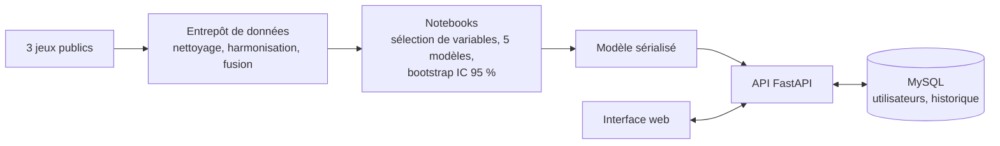

# MédiPredict : prédiction du risque de maladies chroniques

Aide au dépistage du **diabète**, de l'**hypertension** et des **maladies cardiaques** à partir de 20 indicateurs cliniques et de mode de vie.
Le projet couvre la chaîne complète : entrepôt de données, comparaison de 5 modèles avec intervalles de confiance, puis mise en production dans une **API FastAPI + MySQL** avec authentification JWT et une interface web.

> **Résultat :** XGBoost atteint une **AUC-ROC de 0,940 [IC 95 % 0,938–0,942]** sur 55 741 dossiers de test (score de Brier 0,088), à partir d'un entrepôt de **280 985 dossiers** fusionnés depuis 3 sources publiques.

Projet d'équipe (5 étudiants), Master IA et Objets Connectés, Université Ibn Tofail, 2026.

## Mon rôle

J'étais responsable de toute la partie modélisation et de l'application :
- **entraînement et évaluation des modèles** : 5 algorithmes, optimisation des hyperparamètres, validation croisée stratifiée, seuil de Youden, intervalles de confiance par bootstrap ;
- **choix du modèle final** (XGBoost) à partir des métriques de discrimination et de calibration ;
- **développement de l'application** : API FastAPI (authentification JWT, historique et statistiques sous MySQL) et interface web.

---

## Résultats

Après suppression des doublons : 222 960 dossiers d'entraînement et 55 741 de test (découpage 80/20 stratifié). Intervalles de confiance à 95 % par bootstrap (1 000 rééchantillonnages).

| Modèle | AUC-ROC [IC 95 %] | AUC-PR | Accuracy | Sensibilité | Spécificité | MCC | Brier |
| --- | --- | --- | --- | --- | --- | --- | --- |
| **XGBoost** (retenu) | **0,940** [0,938–0,942] | 0,963 | 0,846 | 0,859 | 0,825 | 0,677 | **0,088** |
| Random Forest | 0,940 [0,938–0,942] | 0,963 | 0,850 | 0,863 | 0,820 | 0,677 | 0,091 |
| LightGBM | 0,939 [0,937–0,941] | 0,963 | 0,843 | 0,853 | 0,825 | 0,670 | 0,092 |
| SVM (noyau RBF) | 0,922 [0,920–0,924] | 0,950 | 0,838 | 0,851 | 0,817 | 0,660 | 0,099 |
| Régression logistique | 0,857 [0,854–0,860] | 0,913 | 0,750 | 0,708 | 0,819 | 0,510 | 0,149 |

**Lecture :** les modèles à base d'arbres dominent nettement la régression logistique, signe de fortes interactions non linéaires entre les variables. Entre XGBoost et Random Forest, les intervalles se recouvrent. XGBoost est retenu pour sa meilleure calibration (Brier plus bas), essentielle quand on affiche une probabilité à un soignant.

## Données

| Source | Dossiers | Maladie ciblée |
| --- | --- | --- |
| Jeu « hypertension » | 174 982 | Hypertension |
| Jeu « diabetes » | 96 128 | Diabète |
| Jeu « heart » | 9 875 | Maladie cardiaque |
| **Total (entrepôt fusionné)** | **280 985** | |

- **Cible binaire** : `Abnormal` (au moins une des 3 maladies, 62 %) ou `Normal` (38 %). Les combinaisons de maladies sont aussi conservées (8 sous-classes).
- **20 variables retenues** : âge, IMC, HbA1c, glycémie, cholestérol, triglycérides, CRP, tension, sommeil, activité physique, stress, sucre, tabac, antécédents familiaux, sexe, niveau d'études, emploi.
- Les jeux de données sources sont publics (Mendeley Data) et ne sont pas redistribués ici.

## Architecture



**API (7 routes)** : `POST /register`, `POST /login` (JWT), `GET /me`, `POST /predict` (probabilité et classe), `GET /history`, `GET /stats`, `GET /`.

L'API sert XGBoost avec le **seuil de décision de Youden (0,689)** issu de l'évaluation, et non le seuil par défaut de 0,5. Les prédictions de l'application correspondent ainsi aux sensibilité et spécificité du tableau.

## Structure

```text
├── backend/
│   ├── app.py            # routes FastAPI
│   ├── auth.py           # JWT et hachage bcrypt
│   ├── config.py         # configuration lue dans .env
│   ├── database.py       # connexion MySQL (SQLAlchemy)
│   ├── models.py         # tables users et predictions
│   ├── preprocess.py     # mise en forme des 20 variables
│   ├── schemas.py        # validation Pydantic des entrées
│   └── model/            # xgboost.pkl et scaler.pkl
├── frontend/index.html   # interface web
├── notebooks/            # préparation des données et comparaison des modèles
├── results/              # métriques de tous les modèles
└── data/README.md        # origine des données (non publiées)
```

## Lancer l'application

Prérequis : Python 3.10 ou plus récent et un serveur MySQL avec une base `medical_db` vide. Les tables sont créées au démarrage.

```bash
git clone https://github.com/youri-nkouakep/medipredict.git && cd medipredict
cp .env.example .env                  # puis renseigner SECRET_KEY et DATABASE_URL
pip install -r backend/requirements.txt
cd backend && uvicorn app:app --reload
```

- **Documentation interactive (Swagger)** : http://127.0.0.1:8000/docs
- **Interface** : ouvrir `frontend/index.html` dans le navigateur.

---

## Feuille de route

Le projet fonctionne, mais une version « production » demande plus de rigueur. Voici ce qui est prévu, par ordre de priorité.

### 1. Sécurité et propreté du dépôt
- [x] Historique réécrit : aucun secret, aucun environnement virtuel ni fichier généré
- [x] Secrets et connexion à la base dans un `.env`, avec un `.env.example` publié
- [x] Aucune donnée dans le dépôt ; seul le modèle final (7 Mo) est versionné

### 2. Cohérence entre l'étude et l'application
- [x] L'API sert XGBoost, le modèle retenu, avec son seuil de décision de Youden
- [ ] Un seul **pipeline scikit-learn** sérialisé (prétraitement + modèle), pour que l'API prétraite exactement comme à l'entraînement

### 3. Rigueur ML
- [ ] **Étude de généralisation entre sources** : entraînement sur 2 sources, test sur la 3e, pour chaque combinaison. Objectif : vérifier que le modèle apprend la clinique et non l'origine des données, puis expliquer honnêtement l'écart d'AUC.
- [ ] **Explicabilité SHAP** : importance globale des variables et explication de chaque prédiction
- [ ] **Courbe de calibration**, en complément du score de Brier
- [ ] **Audit d'équité** : performances par sexe et par tranche d'âge, avec les écarts chiffrés
- [ ] **Comparaison avec un réseau de neurones PyTorch** (MLP ou TabTransformer) face aux arbres de décision
- [ ] **Fiche modèle** (*model card*) : usage prévu, limites, risques

### 4. Application
- [ ] `POST /predict` renvoie la probabilité **et les 3 facteurs SHAP** qui l'expliquent
- [ ] `docker compose up` : API + MySQL en une commande
- [ ] Tests `pytest` sur toutes les routes
- [ ] Captures de la documentation Swagger et de l'interface

### 5. MLOps
- [ ] Suivi des expériences avec **MLflow** (paramètres, métriques, modèles versionnés)
- [ ] **CI GitHub Actions** : tests de l'API et refus d'un nouveau modèle moins bon que l'AUC de référence
- [ ] **Surveillance de la dérive des données** (Evidently) sur les prédictions enregistrées en base

### 6. Démo publique
- [ ] Application en ligne (Hugging Face Spaces ou Render) : on saisit un profil patient, on obtient le risque et les 3 facteurs qui l'expliquent

---

## Avertissement

Projet académique. MédiPredict n'est pas un dispositif médical et ne remplace pas un avis médical.
