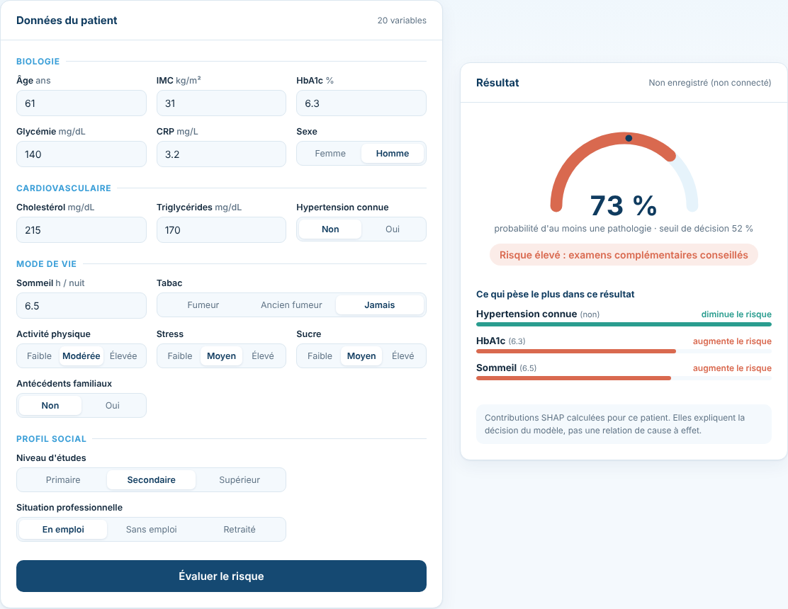
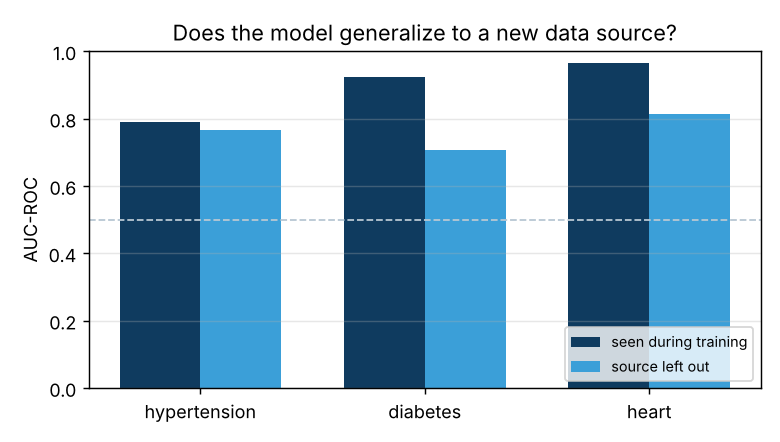
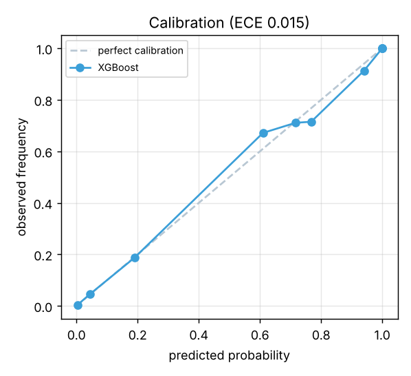
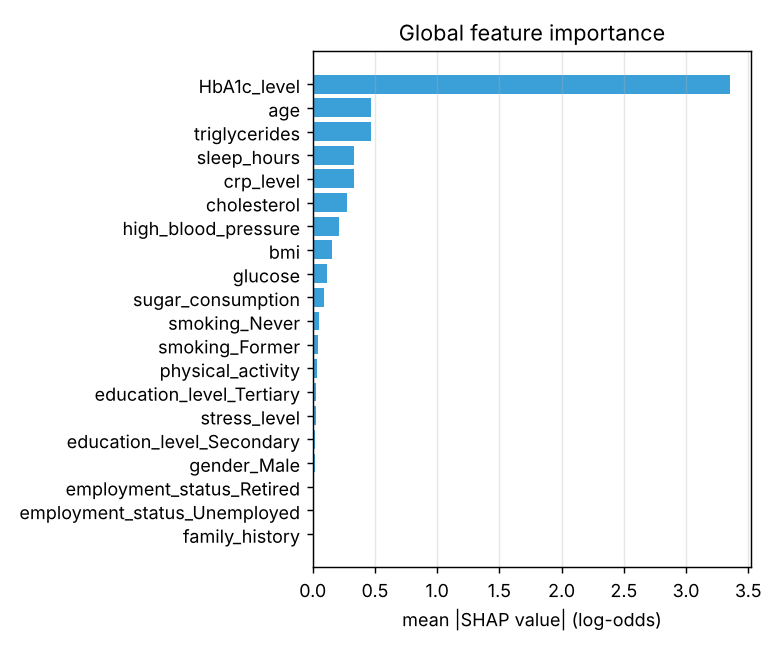
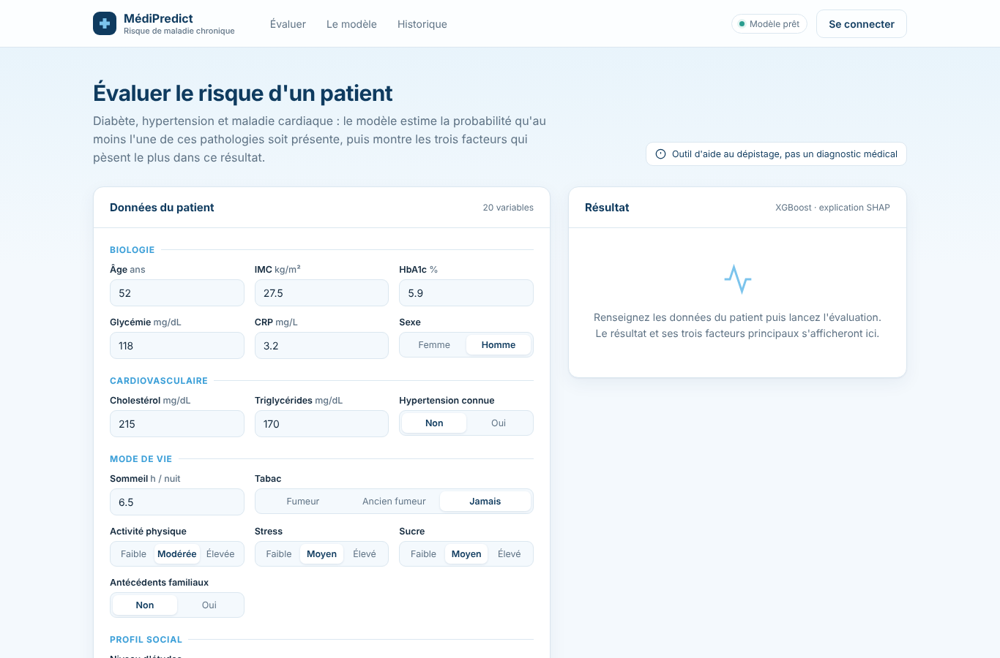
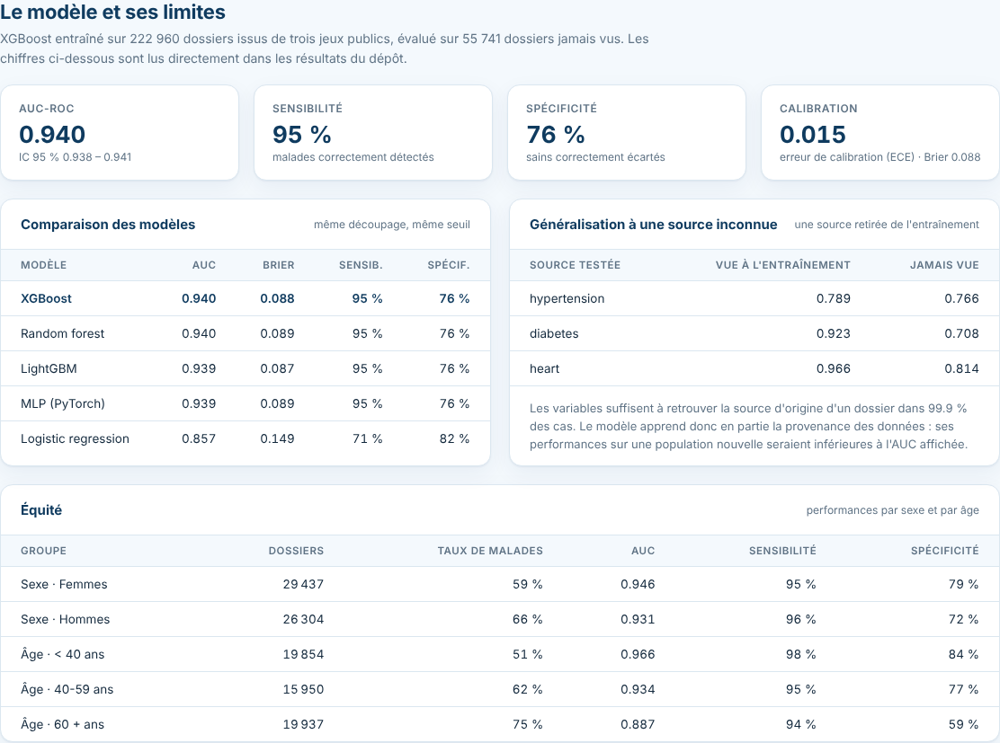
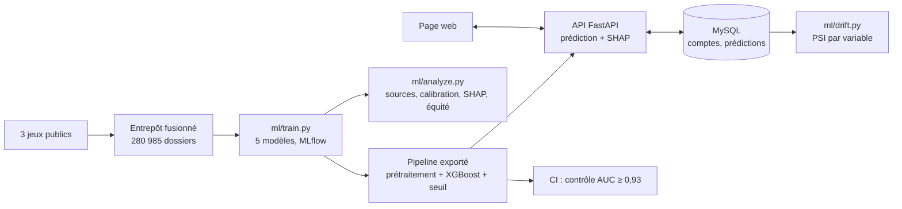

# MédiPredict : prédiction du risque de maladies chroniques

[](https://github.com/youri-nkouakep/Medipredict/actions/workflows/ci.yml)

Aide au dépistage du **diabète**, de l'**hypertension** et des **maladies cardiaques** à partir de 20 indicateurs cliniques et de mode de vie.

Le projet va des données à la production :
- un entrepôt de 280 985 dossiers issus de 3 sources publiques ;
- 5 modèles comparés, dont un réseau de neurones PyTorch ;
- des explications **SHAP** pour chaque patient ;
- des analyses de **généralisation**, de **calibration** et d'**équité** ;
- du **MLOps** : suivi des expériences avec MLflow, CI avec contrôle de qualité du modèle, surveillance de la dérive ;
- une application FastAPI + MySQL avec authentification JWT.

> **Résultat :** XGBoost obtient une **AUC-ROC de 0,940 [IC 95 % 0,938–0,941]** sur 55 741 dossiers de test, avec un modèle bien calibré (ECE 0,015).
> **Limite majeure, mesurée :** les variables suffisent à retrouver la source d'un dossier dans 99,9 % des cas. Sur une source jamais vue, l'AUC tombe entre **0,71 et 0,81**. Le modèle apprend donc en partie la provenance des données (voir [Généralisation](#2-généralisation-à-une-source-inconnue)).



Projet d'équipe (5 étudiants), Master IA et Objets Connectés, Université Ibn Tofail (Maroc), 2026.

## Mon rôle

J'étais responsable de toute la partie modélisation et de l'application :
- **entraînement et évaluation des modèles** ;
- **choix du modèle final** ;
- **développement de l'API et de l'interface**.

J'ai ensuite repris le projet pour y ajouter les analyses de robustesse, l'explicabilité et le MLOps.

---

## 1. Comparaison des modèles

Le découpage est un 80/20 stratifié : 222 960 dossiers d'entraînement et 55 741 de test.

Pour chaque modèle, le **seuil de décision** est choisi par l'indice de Youden sur des prédictions **hors échantillon** (validation croisée en 5 plis). Le choisir sur les prédictions d'entraînement donnerait des seuils faussés : une forêt aléatoire s'y montre presque parfaite. Les intervalles de confiance à 95 % sont obtenus par bootstrap (1 000 rééchantillonnages).

| Modèle | AUC-ROC [IC 95 %] | AUC-PR | Brier | Sensibilité | Spécificité | MCC | Entraînement |
| --- | --- | --- | --- | --- | --- | --- | --- |
| **XGBoost** (retenu) | **0,940** [0,938–0,941] | 0,963 | 0,088 | 95,4 % | 76,1 % | 0,746 | 6 s |
| Random Forest | 0,940 [0,938–0,941] | 0,963 | 0,089 | 95,4 % | 75,9 % | 0,744 | 28 s |
| LightGBM | 0,939 [0,938–0,941] | 0,963 | 0,088 | 95,5 % | 76,1 % | 0,747 | 6 s |
| Réseau de neurones (PyTorch) | 0,939 [0,937–0,941] | 0,963 | 0,089 | 95,1 % | 76,0 % | 0,741 | 22 s |
| Régression logistique | 0,857 [0,854–0,860] | 0,913 | 0,149 | 70,8 % | 81,9 % | 0,510 | 0,3 s |

- Les quatre modèles non linéaires plafonnent **tous** à 0,94, et leurs intervalles se recouvrent. La limite vient des données, pas de l'algorithme : la section suivante l'explique.
- XGBoost est retenu pour sa rapidité, sa légèreté (3 Mo contre 33 pour la forêt aléatoire) et ses explications SHAP exactes.

## 2. Généralisation à une source inconnue

Chaque source est retirée à tour de rôle de l'entraînement, puis le modèle est testé sur elle.

| Source testée | Dossiers | AUC si la source est vue à l'entraînement | AUC si elle n'a jamais été vue |
| --- | --- | --- | --- |
| hypertension | 174 982 | 0,789 | 0,766 |
| diabète | 93 844 | 0,923 | **0,708** |
| cœur | 9 875 | 0,966 | 0,814 |



- **La source seule prédit déjà la cible** avec une AUC de 0,83, parce que les taux de malades vont de 17 % (diabète) à 86 % (hypertension).
- **Les 20 variables permettent de retrouver la source** d'un dossier dans **99,9 %** des cas. Lors de la fusion, des variables absentes d'une source ont été complétées, ce qui a laissé une signature propre à chaque source.
- Conséquence : l'AUC globale de 0,94 surestime ce qu'on obtiendrait sur une **nouvelle population**, plus proche de 0,71 à 0,81.

C'est la principale limite du projet. Peu d'études sur des jeux fusionnés la mesurent.

## 3. Calibration et explicabilité

| Calibration | Importance globale (SHAP) |
| --- | --- |
|  |  |

- **Calibration :** une probabilité affichée de 70 % correspond bien à environ 70 % de malades (ECE 0,015). C'est indispensable quand un soignant lit une probabilité.
- **Explicabilité :** pour chaque patient, l'API renvoie les **3 contributions SHAP** les plus fortes (TreeExplainer, exact pour les arbres). HbA1c domine, mais ce poids reflète en partie l'artefact de fusion décrit plus haut : HbA1c n'existe à l'origine que dans le jeu « diabète ».

## 4. Équité

Les performances sont mesurées par groupe, sur le jeu de test, au seuil de décision.

| Groupe | Dossiers | Taux de malades | AUC | Sensibilité | Spécificité |
| --- | --- | --- | --- | --- | --- |
| Femmes | 29 437 | 59 % | 0,946 | 95,2 % | 79,4 % |
| Hommes | 26 304 | 66 % | 0,931 | 95,5 % | 71,7 % |
| Moins de 40 ans | 19 854 | 51 % | 0,966 | 98,4 % | 84,3 % |
| 40 à 59 ans | 15 950 | 62 % | 0,934 | 94,7 % | 77,5 % |
| 60 ans et plus | 19 937 | 75 % | 0,887 | 93,7 % | **58,7 %** |

La sensibilité reste stable d'un groupe à l'autre, mais **la spécificité chute avec l'âge**. Plus de 4 patients sains de 60 ans et plus sur 10 seraient orientés à tort vers des examens. En pratique, il faudrait un seuil adapté à chaque tranche d'âge, ou des données plus représentatives des seniors en bonne santé.

## 5. MLOps

| Brique | Mise en œuvre |
| --- | --- |
| **Suivi des expériences** | Chaque entraînement est enregistré dans **MLflow** (paramètres, métriques, modèle exporté). Pour les consulter : `mlflow ui --backend-store-uri sqlite:///mlflow.db` |
| **Pipeline unique** | Prétraitement et modèle sont sérialisés ensemble (`backend/model/medipredict.joblib`) : l'API prétraite exactement comme à l'entraînement |
| **CI GitHub Actions** | À chaque push : tests de l'API et du code ML, puis **contrôle de qualité**. Le modèle doit garder une AUC ≥ 0,93 sur un échantillon fixe de 5 000 patients, sinon la CI échoue |
| **Surveillance de la dérive** | L'API enregistre les variables de chaque prédiction. `python -m ml.drift --db <url>` compare cette population à celle de l'entraînement avec le **PSI** et le test de Kolmogorov-Smirnov, puis alerte au-delà de 0,25 |

Exemple avec `python -m ml.drift --simulate`, qui génère une population plus âgée et moins active :

| Variable | PSI | Moyenne à l'entraînement | Moyenne actuelle | Statut |
| --- | --- | --- | --- | --- |
| age | 0,290 | 50,1 | 61,9 | **dérive majeure** |
| employment_status_Retired | 0,169 | 0,34 | 0,54 | dérive modérée |
| physical_activity | 0,060 | 1,13 | 0,86 | stable |

## 6. L'application

| Formulaire | Le modèle et ses limites |
| --- | --- |
|  |  |

- **Interface :** une seule page HTML/CSS/JS, servie par l'API.
  - Une jauge montre la probabilité et le seuil de décision.
  - Les 3 facteurs SHAP sont affichés en clair, avec leur sens (augmente ou diminue le risque).
  - Une section présente la comparaison des modèles, la généralisation et l'équité.
  - Après connexion, un historique liste les évaluations.
- **API :** voici les routes principales.

  | Route | Rôle |
  | --- | --- |
  | `POST /predict` | Probabilité, décision et 3 facteurs SHAP |
  | `GET /model` | Résultats d'évaluation affichés dans l'interface |
  | `POST /register`, `POST /login` | Création de compte et connexion (JWT) |
  | `GET /history`, `GET /stats` | Historique et statistiques de l'utilisateur connecté |
  | `GET /health` | État du service |

  La documentation Swagger est disponible sur `/docs`.



## Lancer le projet

**Avec Docker (API + MySQL) :**

```bash
git clone https://github.com/youri-nkouakep/Medipredict.git && cd Medipredict
cp .env.example .env          # puis renseigner SECRET_KEY et MYSQL_PASSWORD
docker compose up --build     # application sur http://localhost:8000
```

**Sans Docker**, avec Python 3.12 ou plus récent et une base SQLite (rien à installer côté base de données) :

```bash
pip install -r backend/requirements.txt
cp .env.example .env          # garder DATABASE_URL=sqlite:///./medipredict.db
cd backend && uvicorn app:app --reload
```

**Sous Windows (PowerShell)**, même démarrage sans Docker :

```powershell
cd $HOME\Documents                # éviter C:\WINDOWS\system32, dossier où PowerShell s'ouvre par défaut
git clone https://github.com/youri-nkouakep/Medipredict.git
cd Medipredict
python -m venv venv
.\venv\Scripts\Activate.ps1       # si les scripts sont bloqués : Set-ExecutionPolicy RemoteSigned -Scope CurrentUser
pip install -r backend\requirements.txt
copy .env.example .env            # puis remplacer SECRET_KEY (commande de génération dans le fichier)
cd backend
uvicorn app:app                   # application sur http://127.0.0.1:8000
```

**Réentraîner et refaire les analyses.** Il faut l'entrepôt `data/data_warehouse.csv` (non publié, voir `data/README.md`) :

```bash
pip install -r requirements-ml.txt
python -m ml.train        # 5 modèles, environ 5 min sur CPU, suivi dans MLflow
python -m ml.analyze      # généralisation, calibration, SHAP, équité
python -m ml.quality_gate
python -m pytest
```

## Structure

```text
backend/        # API FastAPI : app.py, predictor.py (pipeline + SHAP), auth, base de données
frontend/       # interface (une page HTML/CSS/JS)
ml/             # data.py, models.py (dont le réseau PyTorch), metrics.py, train.py, analyze.py, drift.py, quality_gate.py
data/           # échantillons de contrôle (CI) et de référence (dérive) ; l'entrepôt complet n'est pas publié
results/        # tous les chiffres de ce README, et les figures
notebooks/      # exploration initiale du projet d'équipe
docs/           # fiche modèle (MODEL_CARD.md) et captures
tests/          # tests de l'API et du code ML
.github/        # CI
```

La [fiche modèle](docs/MODEL_CARD.md) résume l'usage prévu, les performances et les limites.

## Données

| Source | Dossiers | Maladie ciblée |
| --- | --- | --- |
| Jeu « hypertension » | 174 982 | Hypertension |
| Jeu « diabetes » | 96 128 | Diabète |
| Jeu « heart » | 9 875 | Maladie cardiaque |

- **Cible :** `Abnormal` si au moins une des 3 maladies est présente (62 % des dossiers), sinon `Normal`.
- **20 variables :** âge, IMC, HbA1c, glycémie, cholestérol, triglycérides, CRP, hypertension connue, sommeil, activité physique, stress, sucre, tabac, antécédents familiaux, sexe, niveau d'études, situation professionnelle.
- Les jeux sources sont publics (Mendeley Data). Seuls deux échantillons de 5 000 lignes sont versionnés, pour la CI et la surveillance de la dérive.

## Avertissement

Projet académique. MédiPredict n'est pas un dispositif médical et ne remplace pas un avis médical.
